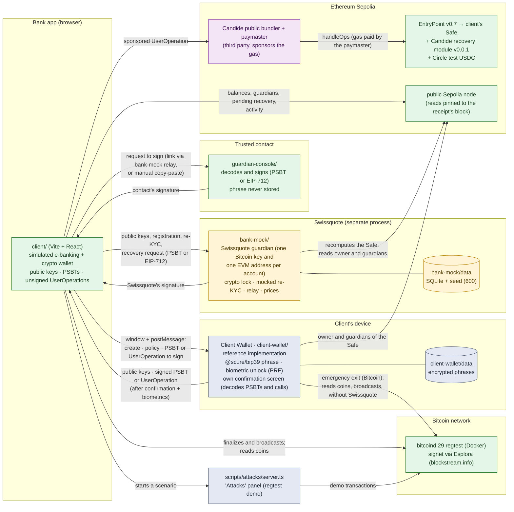
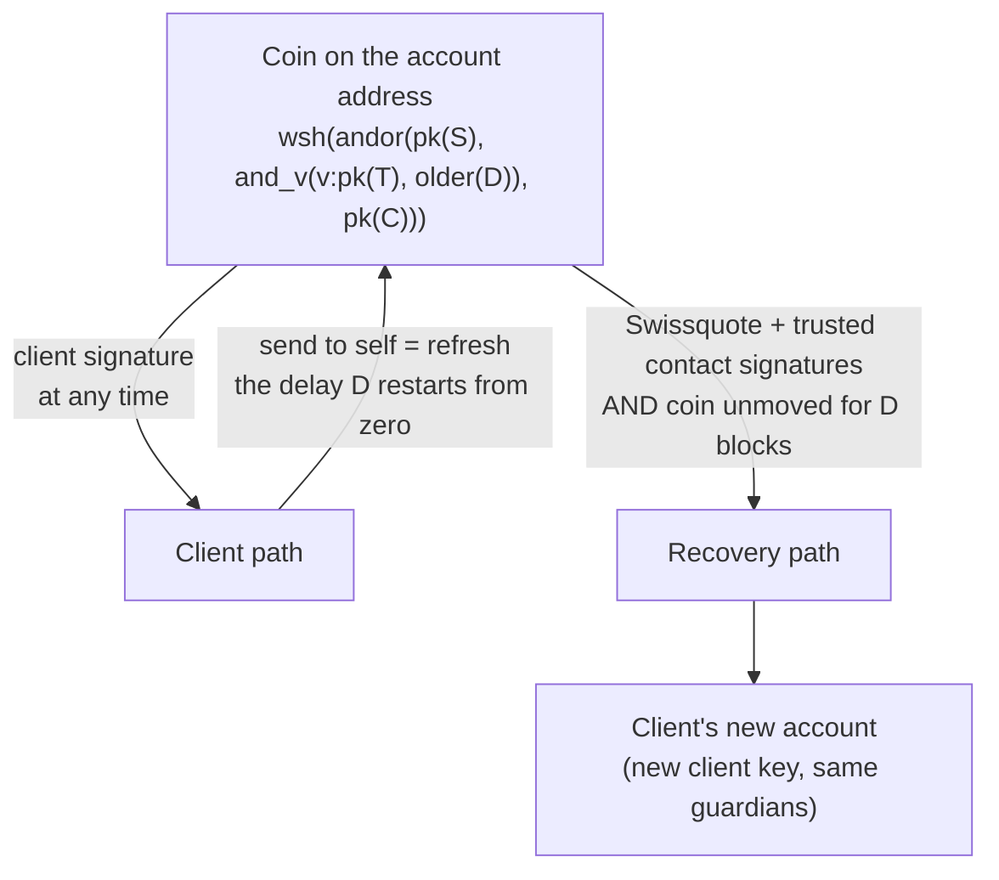
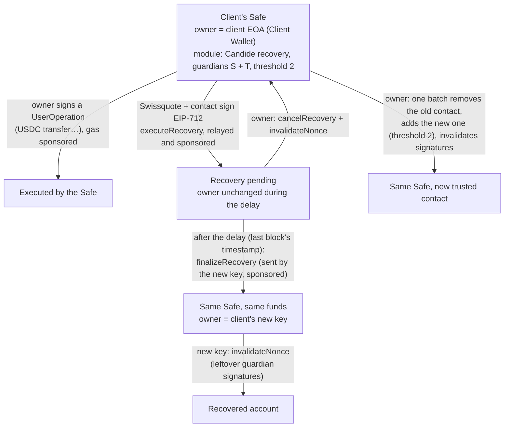

# Architecture

Three principles:
1. **No private key in the app**: it only handles public keys, PSBTs (Bitcoin) and unsigned UserOperations (Ethereum).
2. **The recovery rules are enforced on-chain**, not by Swissquote: by Bitcoin consensus (Miniscript `older(D)`), and on Ethereum by the Safe and Candide's recovery module (two guardian signatures, delay, cancellation by the owner).
3. **Each guardian is a separate process or person**, with its own storage.

One secret phrase in the Client Wallet gives both accounts: Bitcoin (BIP-32 account key) and Ethereum (EOA `m/44'/60'/0'/0/0`, owner of a Safe). The same applies to the trusted contact (one phrase in their console). Swissquote derives, from its own seed in bank-mock, one Bitcoin key and one Ethereum guardian address **per client account** (step 56), so its guardian role does not link its clients to one another on-chain.

Legend: green = real, yellow = mocked, grey-blue = reference implementation or demo tool, purple = third-party service.

The relay between the app and the trusted-contact console goes through bank-mock (`/relay`): the client deposits the request signed by Swissquote, the contact opens it through a link (`?req=…`) and sends back their signature. bank-mock only accepts a signed version of the same Bitcoin transaction, or, for Ethereum, an EIP-712 signature it verifies against the contact registered for that Safe. If Swissquote is unavailable, the manual exchange remains.

Network exposure: the Client Wallet, bank-mock and the attack server listen on the loopback interface only; the wallet
also rejects a foreign `Host` header. On regtest, the bank app reaches bitcoind through a development relay
(`client/vite.config.ts`) that forwards only the RPC methods the app uses, on read-only `sq-watch-*` wallets.

Crypto lock: the bank's crypto part opens only after a passkey (biometrics) checked by bank-mock, and relocks when the
client leaves it; a re-KYC opens only the recovery screens. Wallets belong to the device: the app finds the active
account in the device's own storage (public keys), never by asking Swissquote which wallets exist (step 40).

Account policy: the bank app sends it to the Client Wallet, which shows the trusted contact's name and fingerprint,
Swissquote's fingerprint and the delay, and saves it only after biometrics. The contact's console shows the same
fingerprint, to be compared by another channel.

Other Bitcoin signers: Bitcoin Core (`walletprocesspsbt`, validated) can replace the Client Wallet through the "Other external wallet (PSBT)" option; `tools/client-signer` serves the test scripts.

## Bitcoin: policy and spending paths

## Ethereum: Safe, recovery module and gasless

How a gasless operation is built (`packages/evm`, `abstractionkit` 0.4.3):

1. The app builds the UserOperation (`SafeAccountV0_3_0`, EntryPoint v0.7): calls to execute, Safe deployment if needed. If the public node still returns the Safe's previous nonce right after an operation (bundler error AA25), the estimation is retried (step 63).
2. Candide's public paymaster (ERC-7677, `Erc7677Paymaster`) adds its sponsorship data and gas limits.
3. The Client Wallet receives the UserOperation, reads the Safe's owner and guardians **on-chain itself**, decodes **every call** (USDC transfer or approve, module and guardian calls, MultiSend batches) and refuses anything it cannot decode, as well as any change of guardians other than the initial activation (two distinct guardians, threshold 2, the owner not among them) or a checked change of trusted contact (step 48, step 58). It signs only after biometrics.
4. The app sends it to the bundler and waits for the receipt; every following read is pinned to the receipt's block (the public node can return stale state, observed at steps 16 and 17).

The paymaster belongs to Candide, not Swissquote. Our design does not depend on it for custody: without it, the owner's key can still send the same operations as transactions paid in ETH (not tested).

## Main flows

| Flow | Steps | Who signs | Depends on Swissquote? |
| --- | --- | --- | --- |
| Login | Public "Markets" page → login: bank-mock session, fictitious CHF accounts; the crypto part opens after a passkey checked by bank-mock | — | Yes (simulated bank) |
| Wallet creation (Bitcoin) | The contact sends their public key → the Client Wallet generates the phrase, shows it once, encrypts it with biometrics, returns the public key → the app gets Swissquote's key for this account, compiles the policy, registers the account → the wallet shows the policy (contact fingerprint) and stores it after biometrics | — | Yes (Swissquote key and registration) |
| Ethereum account | The Client Wallet derives the EOA from the same phrase → the contact's Ethereum address (from their console) → Swissquote **recomputes** the Safe address from the owner and registers it, with its own guardian address for this account → activation: one sponsored UserOperation deploys the Safe, enables the module, adds both guardians, threshold 2 | Client | Yes (registration); the deployment itself needs only the bundler and paymaster |
| Client spend | Bitcoin: the app prepares and simulates the PSBT → the Client Wallet decodes it, asks for confirmation, signs → the app finalizes and broadcasts. Ethereum: "Send USDC" prepares a sponsored UserOperation and opens the Client Wallet, which decodes and signs it (step 63) | Client | **No** (Bitcoin: attack 3, and the Client Wallet's emergency exit. Ethereum: owner's key alone; bundler and paymaster are third parties) |
| Refresh (Bitcoin) | Send all coins to a fresh change address of the account | Client | No |
| Recovery (Bitcoin) | Re-KYC → old account found → new key → recovery PSBT → bank-mock signs → the contact signs in their console (link relayed by Swissquote) → the app combines, finalizes, broadcasts; real `non-BIP68-final` rejection before D | Swissquote + trusted contact | Yes (by design) |
| Recovery (Ethereum) | Re-KYC → new Client Wallet → its EOA → bank-mock signs the EIP-712 request (only for a Safe of this client, to a key that is neither the owner nor a guardian; alert to the client) → the contact checks on-chain they are a guardian and signs → the new key's own Safe relays `executeRecovery` (sponsored) → delay → `finalizeRecovery` → `invalidateNonce` → bank-mock syncs the owner from the chain | Swissquote + trusted contact; the client can cancel | Yes (by design) |
| Cancellation (Ethereum) | The current owner sends `cancelRecovery` + `invalidateNonce` during the delay (sponsored) | Client | No |
| Change of trusted contact | Bitcoin: coins moved by the client alone to the policy with the new contact, then Swissquote's registry and the wallet's policy updated (step 43). Ethereum: one batch checked by the Client Wallet against the guardians it reads on-chain; bank-mock updates its registry only once the chain shows the change (step 58) | Client | Registry only |
| Account ↔ wallet transfer | Bitcoin only. Withdrawal: ownership proof signed by the Client Wallet → Swissquote's omnibus wallet sends on-chain → Travel Rule record. Deposit: credited only if all inputs come from a registered wallet of the client | Client (proof) / Swissquote (custody) | Yes (custody account) |

## Components

| Folder | Role | Real / mocked |
| --- | --- | --- |
| `packages/bitcoin` | Miniscript policy, descriptors, scan, PSBT, simulation, finalization, Esplora (with browser cache) and bitcoind backends. `index.ts` exposes no key or signature; `sign.ts` and `keys.ts` are reserved for tools, bank-mock, the console and the Client Wallet | Real |
| `packages/evm` | Safe address, sponsored UserOperations (abstractionkit), plain-language decoding and guardian-change checks of an operation, state read at a given block with retries, on-chain activity (USDC transfers, module events). `index.ts` exposes no key; `keys.ts` (EVM derivation) is imported only by the Client Wallet, bank-mock and the console | Real |
| `client/` | Bank app (port 5173): public site, login, Overview, Accounts, crypto wallet behind the crypto lock (network selector Bitcoin / Ethereum), recovery, Demo | Wallet real; bank and session simulated |
| `client-wallet/` | Client Wallet (port 5180): a single process (API + Vite interface as middleware), storage in `client-wallet/data/`, biometric unlock (WebAuthn PRF), Bitcoin emergency exit without Swissquote | Reference implementation |
| `bank-mock/` | Simulated bank and Swissquote guardian (port 4000): login, crypto lock, fictitious CHF accounts, Bitcoin keys and EVM guardian addresses per account, Bitcoin and Ethereum accounts, mocked re-KYC, signing limited to recoveries, custody account and Travel Rule records, relay to the trusted contact, alerts, market prices (CoinGecko, cached), log | Mocked |
| `guardian-console/` | Trusted-contact console (port 5174): identity creation (Bitcoin key + Ethereum address), decoding, signing (PSBT or EIP-712), relay | Real (logic) |
| `tools/client-signer`, `tools/keygen` | Signer and seed generator for the test scripts | Test tools |
| `scripts/attacks/` | Bitcoin attack scenarios (tests and panel, port 4200) | Real against regtest, throw-away seeds |
| `scripts/feasibility/` | Ethereum scripts on the real Sepolia (gasless deployment, full journey with refusals, cancellation), throwaway keys in memory | Real |
| `docker/regtest.yml` | bitcoind 29 regtest | Real |

External services: Candide public bundler and paymaster (`api.candide.dev/public/v3/11155111`), public Sepolia node (`ethereum-sepolia-rpc.publicnode.com`), blockstream.info Esplora (signet), CoinGecko (prices). Defaults in `packages/evm/src/index.ts` and `bank-mock/src/market.ts`, overridable by environment variables (`VITE_EVM_*` / `EVM_*`, `MARKET_API`).

## Libraries (no home-made cryptography)

Bitcoin: `@bitcoinerlab/miniscript-policies` 1.1.0 (sipa's reference compiler), `@bitcoinerlab/miniscript` 2.0.0, `@bitcoinerlab/descriptors-scure` 3.2.0 (`@scure/btc-signer`, `@scure/bip32`, `@noble/curves`), `bip322-js` 4.0.0.
Ethereum: `viem` 2.57.4 (keys, EIP-712 signatures, reads), `abstractionkit` 0.4.3 (Safe accounts, recovery module, UserOperations, bundler and paymaster).
Common: `@scure/bip39` 2.4.0, `@scure/base` 2.4.0, `@simplewebauthn/server` 14.0.3 and `/browser` 14.0.0, WebAuthn PRF through the browser API and `node:crypto` (HKDF, AES-256-GCM) for the Client Wallet, React 19.3, Vite 8.3, `node:sqlite` (Node 24), `playwright-core` 1.64 (tests only).
