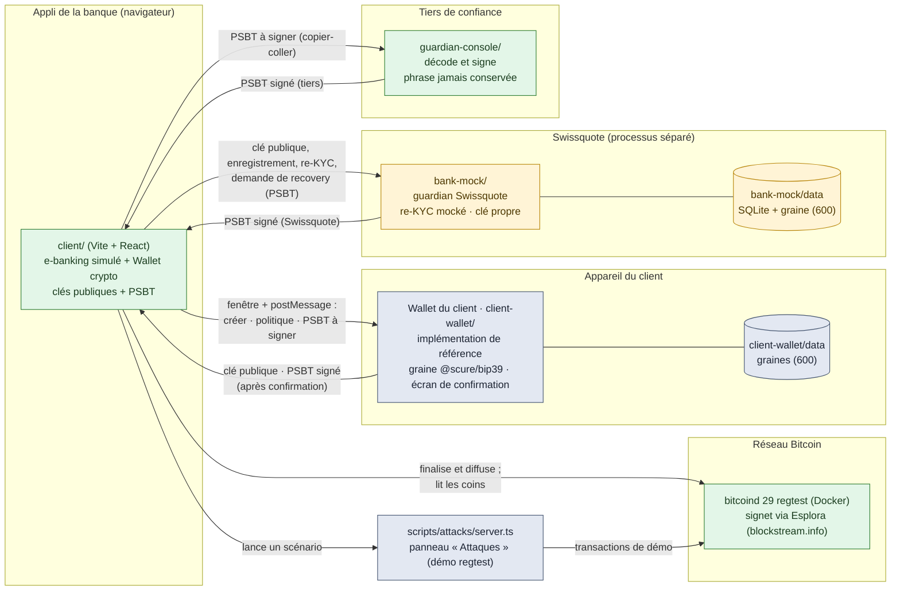
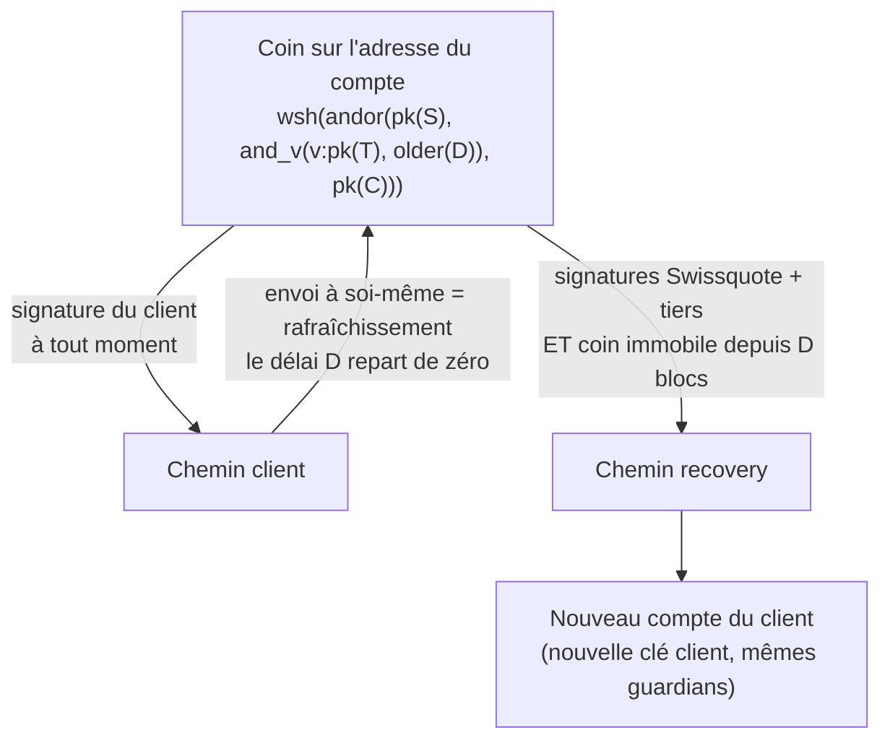

# Architecture

Trois principes :
1. **Aucune clé privée dans l'appli** : elle ne manipule que des clés publiques et des PSBT.
2. **La politique de dépense est appliquée par le consensus Bitcoin**, pas par Swissquote.
3. **Chaque guardian est un processus ou une personne séparée**, avec son propre stockage.

Légende : vert = réel, jaune = mocké, gris-bleu = implémentation de référence ou outil de démo.

Autres signataires : Bitcoin Core (`walletprocesspsbt`, validé) peut remplacer le Wallet du client via l'option « Autre wallet externe (PSBT) » ; `tools/client-signer` sert aux scripts de test.

## Politique et chemins de dépense

## Flux principaux

| Flux | Étapes | Qui signe | Dépend de Swissquote ? |
| --- | --- | --- | --- |
| Connexion | e-banking simulé : session bank-mock, comptes CHF fictifs | — | Oui (banque simulée) |
| Création du wallet | Le tiers transmet sa clé publique → le Wallet du client génère la graine, l'affiche une fois, renvoie la clé publique → l'appli obtient la clé Swissquote, compile la politique, enregistre le compte → le wallet enregistre la politique | — | Oui (clé et enregistrement Swissquote) |
| Dépense du client | L'appli prépare le PSBT et le simule → le Wallet du client le décode et le fait confirmer, puis signe → l'appli finalise et diffuse | Client | **Non** (attaque 3 ; compte en cache local) |
| Rafraîchissement | Envoi de tous les coins vers une adresse de change neuve du compte | Client | Non |
| Recovery | Re-KYC → ancien compte retrouvé → nouvelle clé → PSBT de recovery → bank-mock signe → le tiers signe dans sa console → l'appli combine, finalise, diffuse ; refus réel `non-BIP68-final` avant D | Swissquote + tiers | Oui (par conception) |

## Composants

| Dossier | Rôle | Réel / mocké |
| --- | --- | --- |
| `packages/bitcoin` | Politique Miniscript, descripteurs, scan, PSBT, simulation, finalisation, backends Esplora et bitcoind. `index.ts` n'expose ni clé ni signature ; `sign.ts` et `keys.ts` sont réservés aux outils, à bank-mock et à la console | Réel |
| `client/` | Appli de la banque (port 5173) : connexion, Aperçu, Comptes, Wallet crypto, recovery, Démo | Wallet réel ; banque et session simulées |
| `client-wallet/` | Wallet du client (port 5180) : un seul processus (API + interface Vite en middleware), stockage `client-wallet/data/` | Implémentation de référence |
| `bank-mock/` | Banque simulée et guardian Swissquote (port 4000) : connexion, comptes CHF fictifs, clé publique, comptes Bitcoin, re-KYC mocké, signature limitée aux recoveries, journal | Mocké |
| `guardian-console/` | Console du tiers (port 5174) : création de l'identité, décodage, signature | Réel (logique) |
| `tools/client-signer`, `tools/keygen` | Signataire et générateur de graine des scripts de test | Outils de test |
| `scripts/attacks/` | Scénarios d'attaque (tests et panneau, port 4200) | Réel contre regtest, graines jetables |
| `docker/regtest.yml` | bitcoind 29 regtest | Réel |

## Bibliothèques (aucune cryptographie maison)

`@bitcoinerlab/miniscript-policies` 1.1.0 (compilateur de référence de sipa), `@bitcoinerlab/miniscript` 2.0.0, `@bitcoinerlab/descriptors-scure` 3.2.0 (`@scure/btc-signer`, `@scure/bip32`, `@noble/curves`), `@scure/bip39` 2.4.0, `@scure/base` 2.4.0, React 19.3, Vite 8.3, `node:sqlite` (Node 24), `playwright-core` 1.64 (tests uniquement).
