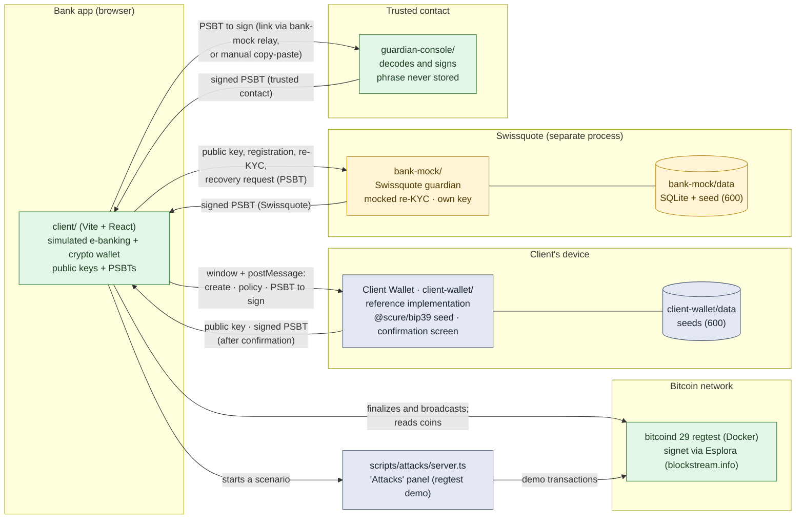
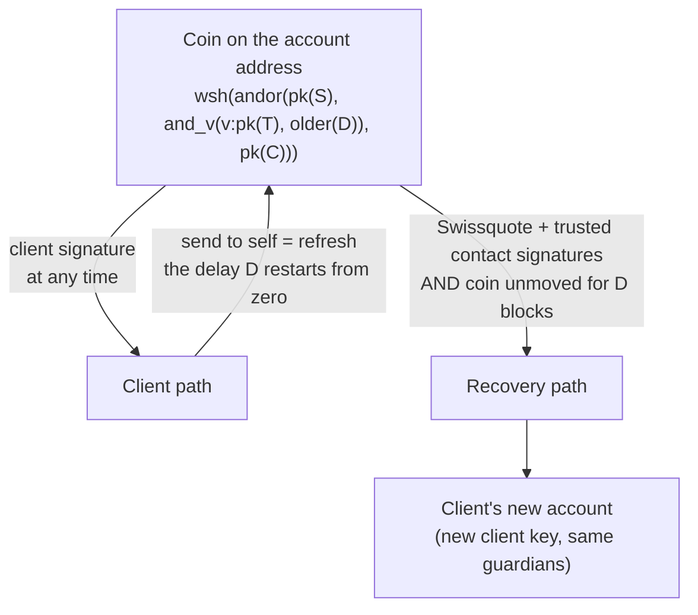

# Architecture

Three principles:
1. **No private key in the app**: it only handles public keys and PSBTs.
2. **The spending policy is enforced by Bitcoin consensus**, not by Swissquote.
3. **Each guardian is a separate process or person**, with its own storage.

Legend: green = real, yellow = mocked, grey-blue = reference implementation or demo tool.

The relay between the app and the trusted-contact console goes through bank-mock (`/relay`): the client deposits the PSBT signed by Swissquote, the contact opens it through a link (`?req=…`) and sends back their signature; bank-mock only accepts a signed version of the same transaction. If Swissquote is unavailable, the manual exchange remains.

Other signers: Bitcoin Core (`walletprocesspsbt`, validated) can replace the Client Wallet through the "Other external wallet (PSBT)" option; `tools/client-signer` serves the test scripts.

## Policy and spending paths

## Main flows

| Flow | Steps | Who signs | Depends on Swissquote? |
| --- | --- | --- | --- |
| Login | Simulated e-banking: bank-mock session, fictitious CHF accounts | — | Yes (simulated bank) |
| Wallet creation | The contact sends their public key → the Client Wallet generates the seed, shows it once, returns the public key → the app gets Swissquote's key, compiles the policy, registers the account → the wallet stores the policy | — | Yes (Swissquote key and registration) |
| Client spend | The app prepares and simulates the PSBT → the Client Wallet decodes it and asks for confirmation, then signs → the app finalizes and broadcasts | Client | **No** (attack 3; account cached locally) |
| Refresh | Send all coins to a fresh change address of the account | Client | No |
| Recovery | Re-KYC → old account found → new key → recovery PSBT → bank-mock signs → the contact signs in their console (link relayed by Swissquote) → the app combines, finalizes, broadcasts; real `non-BIP68-final` rejection before D | Swissquote + trusted contact | Yes (by design) |
| Account ↔ wallet transfer | Withdrawal: ownership proof signed by the Client Wallet → Swissquote's omnibus wallet sends on-chain → Travel Rule record. Deposit: credited only if all inputs come from a registered wallet of the client | Client (proof) / Swissquote (custody) | Yes (custody account) |

## Components

| Folder | Role | Real / mocked |
| --- | --- | --- |
| `packages/bitcoin` | Miniscript policy, descriptors, scan, PSBT, simulation, finalization, Esplora and bitcoind backends. `index.ts` exposes no key or signature; `sign.ts` and `keys.ts` are reserved for tools, bank-mock and the console | Real |
| `client/` | Bank app (port 5173): login, Overview, Accounts, crypto wallet, recovery, Demo | Wallet real; bank and session simulated |
| `client-wallet/` | Client Wallet (port 5180): a single process (API + Vite interface as middleware), storage in `client-wallet/data/` | Reference implementation |
| `bank-mock/` | Simulated bank and Swissquote guardian (port 4000): login, fictitious CHF accounts, public key, Bitcoin accounts, mocked re-KYC, signing limited to recoveries, custody account and Travel Rule records, relay to the trusted contact, log | Mocked |
| `guardian-console/` | Trusted-contact console (port 5174): identity creation, decoding, signing, relay | Real (logic) |
| `tools/client-signer`, `tools/keygen` | Signer and seed generator for the test scripts | Test tools |
| `scripts/attacks/` | Attack scenarios (tests and panel, port 4200) | Real against regtest, throw-away seeds |
| `docker/regtest.yml` | bitcoind 29 regtest | Real |

## Libraries (no home-made cryptography)

`@bitcoinerlab/miniscript-policies` 1.1.0 (sipa's reference compiler), `@bitcoinerlab/miniscript` 2.0.0, `@bitcoinerlab/descriptors-scure` 3.2.0 (`@scure/btc-signer`, `@scure/bip32`, `@noble/curves`), `@scure/bip39` 2.4.0, `@scure/base` 2.4.0, `bip322-js` 4.0.0, `@simplewebauthn/server` 14.0.3 and `/browser` 14.0.0, React 19.3, Vite 8.3, `node:sqlite` (Node 24), `playwright-core` 1.64 (tests only).
